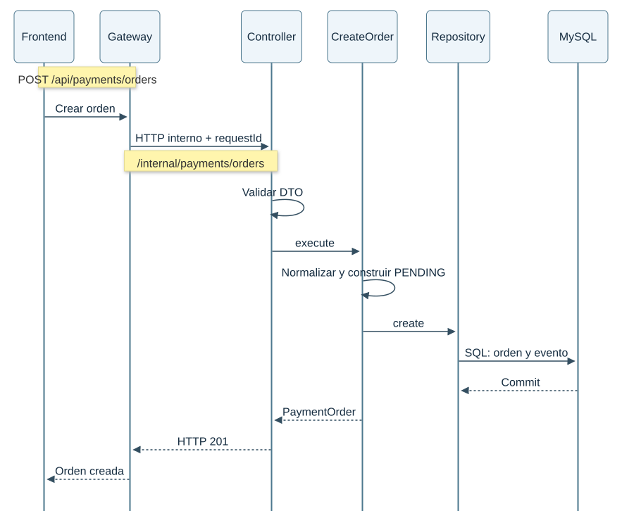
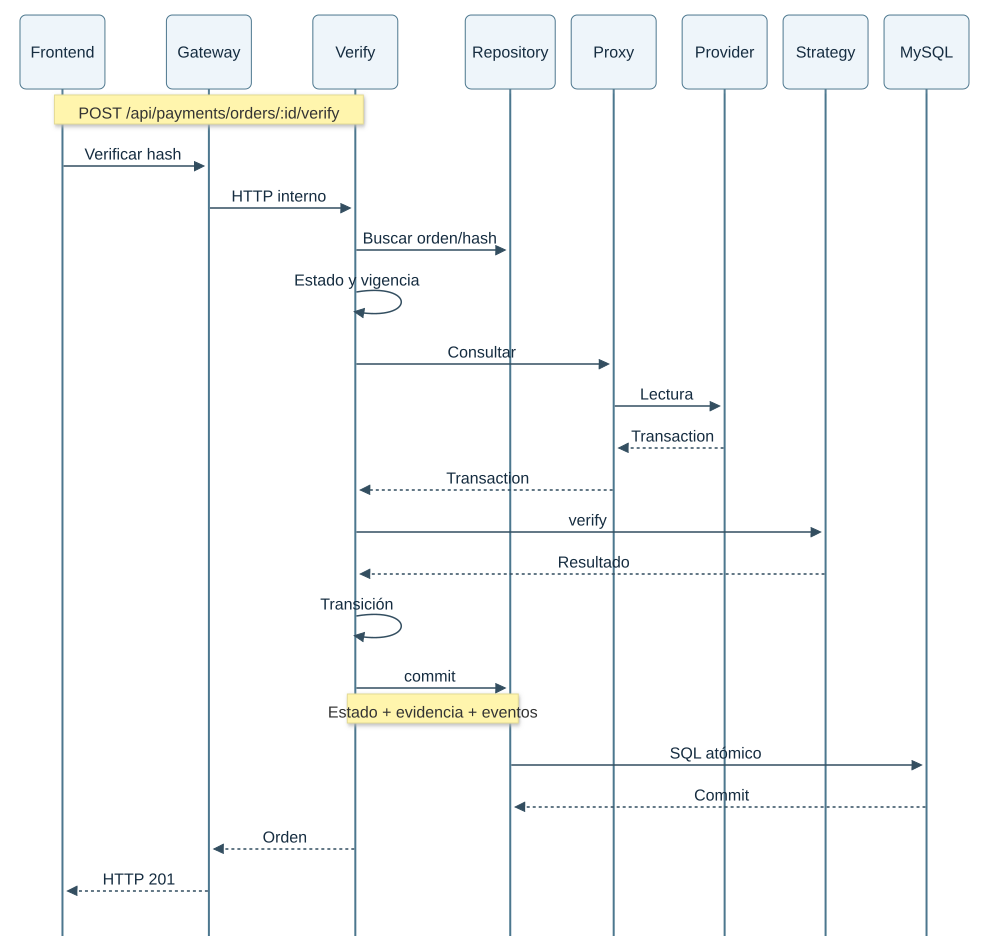
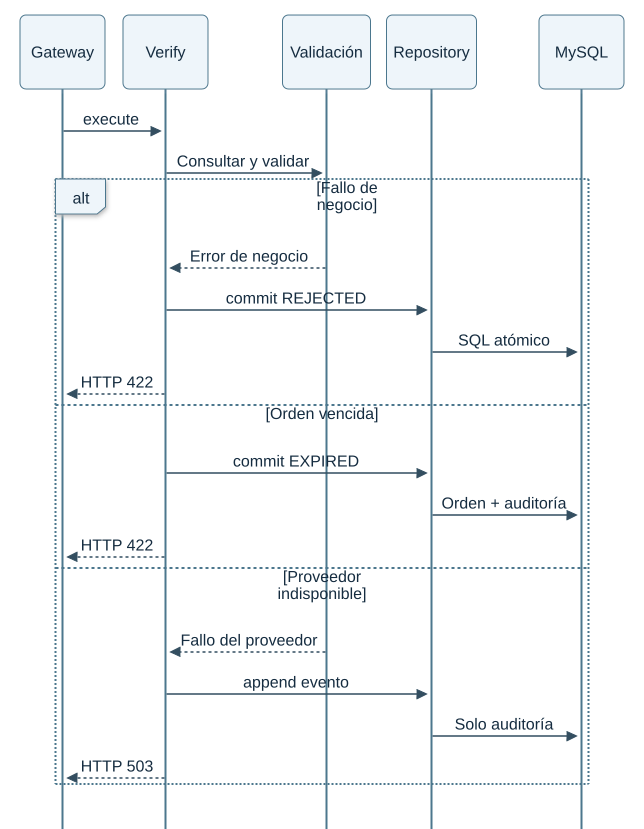
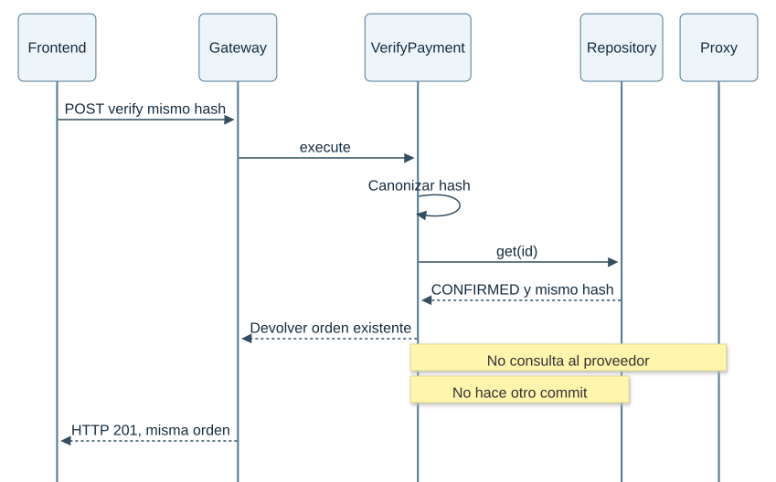

<!-- page: portada -->

# ARVELUNA – Documentación técnica de la Entrega 1

**Implementación del MVP de pagos USDT TRC-20**

| Dato académico | Información disponible |
|---|---|
| Universidad | Universidad del Norte |
| Programa | Ingeniería de Sistemas |
| Asignatura | Diseño de Software 2 |
| Profesor | Daniel Romero Martínez |
| Integrantes | Alberto Russell y Yalal Ajram Elneser |
| Fecha de entrega oficial | 12 de octubre |
| Fecha de elaboración y verificación | 20 de octubre de 2026, America/Bogota |
| Versión del documento | 1.0 |

**Estado del producto:** MVP local ejecutable. Proveedor activo verificado: **simulated**. Adaptador opcional **TronGridPaymentProvider** implementado y probado con respuestas interceptadas; consulta en vivo pendiente.

**Alcance de la evidencia:** revisión del código, esquema Prisma y documentación del árbol de trabajo de la rama `main`, cuyo commit base es `a91bb6c`. Incluye cambios locales todavía sin commit. El estado local descrito puede diferir de la versión publicada en GitHub.

No se ejecutaron pagos reales, firma, envío de transacciones ni despliegues. Este informe no contiene valores privados de configuración. Los datos académicos y la fecha oficial de entrega fueron proporcionados por los integrantes; el año de entrega no fue especificado.

<!-- page: indice -->

## Índice

| Sección | Página |
|---|---:|
| 1. Portada | 1 |
| 2. Resumen ejecutivo | 3 |
| 3. Alcance | 3 |
| 4. Requisitos funcionales y no funcionales | 4–5 |
| 5. Arquitectura C4 | 6–8 |
| 6. Clean Architecture | 9 |
| 7. Patrones implementados | 10–11 |
| 8. Modelo de datos | 12–15 |
| 9. Flujos de creación y verificación | 16–19 |
| 10. API | 20 |
| 11. Manejo de errores y observabilidad | 21 |
| 12. Pruebas y evidencia ejecutada | 22–23 |
| 13. Instalación y ejecución | 24–25 |
| 14. Seguridad | 26 |
| 15. Limitaciones | 27 |
| 16. Arquitectura futura: propuesta | 28 |
| 17. Conclusiones | 29 |
| 18. Referencias y anexos | 30 |

### Convenciones de lectura

Las clases, rutas, estados y nombres de servicios se mantienen en inglés para corresponder con el código. La redacción y las explicaciones se presentan en español.

El prefijo **P/** abrevia `backend/apps/payments-service/src/`; **G/** abrevia `backend/apps/api-gateway/src/`. Las rutas restantes son relativas a la raíz del proyecto. Los diagramas representan responsabilidades y dependencias; no equivalen a un despliegue de producción.

Las figuras 1 a 8 describen el MVP actual. La figura 9 pertenece únicamente a la propuesta futura. Ninguna flecha futura implica que exista un servicio, una cola o una base de datos de ese servicio en esta entrega.

**Fuentes principales:** código local, `backend/prisma/schema.prisma`, migración versionada, controladores, pruebas y comprobaciones repetidas para este informe. Las referencias externas citadas en la documentación del proyecto no reemplazan evidencia ejecutada.

<!-- page: resumen-alcance -->

## 2. Resumen ejecutivo

La identificación de un pago mediante un hash comunicado por una persona no demuestra por sí sola que una transferencia satisfaga una obligación comercial. Debe contrastarse con una fuente de blockchain, comprobar sus condiciones y evitar que se aplique más de una vez.

ARVELUNA aborda este problema mediante órdenes de pago USDT TRC-20 con monto exacto, receptor, contrato, red y vigencia definidos. Un caso de uso consulta el proveedor seleccionado, aplica una estrategia de verificación y conserva evidencia y auditoría. El navegador consume un Gateway; Payments Service es el único propietario de los datos de pagos.

El resultado alcanzado es un MVP local con frontend, dos procesos NestJS, MySQL/Prisma y pruebas automatizadas. El proveedor simulado permite reproducir éxito y fallos sin transferencias. El adaptador TronGrid de solo lectura está implementado y probado offline, pero esa evidencia no demuestra una integración en vivo ni operación con fondos.

## 3. Alcance

### Implementado actualmente

- Crear, consultar y verificar órdenes; consultar su auditoría.
- Validar datos autoritativos, monto en unidades base, red, token, receptor, ejecución, confirmaciones y vigencia.
- Controlar estados, idempotencia y unicidad del hash; persistir evidencia transaccional.
- Frontend adaptable, API Gateway, Payments Service y Payments Database MySQL.
- Proveedor predeterminado simulado y adaptador opcional TronGrid con configuración, normalización y pruebas mediante fixtures.

### Fuera del alcance o futuro

Ventas, inventario, caja, importación, diagnósticos, simulaciones de negocio, recomendaciones, Identity y Merchant como servicios propios no están implementados. `saleId` y `merchantId` son referencias simples.

**RabbitMQ no está instalado ni conectado.** Tampoco existen contratos desplegados por ARVELUNA, custodia, wallets, firma, envío de transacciones, autenticación de producción o monitor automático de cadena. La simulación del proveedor blockchain no constituye un Simulation Service de negocio.

<!-- page: requisitos-funcionales -->

## 4. Requisitos

### 4.1 Requisitos funcionales implementados

| ID | Requisito observable | Evidencia principal |
|---|---|---|
| RF-01 | Crear una orden con referencias externas, receptor y monto decimal como cadena | `CreatePaymentOrder`; DTO y POST de creación |
| RF-02 | Consultar una orden o informar su ausencia | `GetPaymentOrder`; GET por id |
| RF-03 | Aceptar un hash como pista, no como prueba de pago | `VerifyPayment`; puerto `BlockchainProvider` |
| RF-04 | Comparar red, contrato, receptor y monto exacto | `TronUsdtVerificationStrategy` |
| RF-05 | Validar ejecución, vigencia y confirmaciones | Strategy y reglas de estados |
| RF-06 | Evitar uso del hash por otra orden y repetir sin duplicar confirmación | Caso de uso y restricciones SQL |
| RF-07 | Persistir la transferencia normalizada y su evidencia pública | `PrismaPaymentRepositories.commit` |
| RF-08 | Registrar creación, transiciones y fallos relevantes | `audit()` y `PaymentAuditEvent` |
| RF-09 | Mostrar detalle, carga, errores, consulta y auditoría; copiar dirección | `frontend/src/app.js` y `api.js` |
| RF-10 | Seleccionar adaptador sin cambiar reglas de negocio | Factory, configuración y Proxy |

### Criterios concretos de negocio

El monto debe ser positivo y admitir como máximo seis decimales; USDT se representa con seis decimales en este escenario. `toBaseUnits` transforma la cadena a entero con BigInt; no se comparan tokens mediante punto flotante.

La estrategia busca un evento Transfer que cumpla todas las condiciones. No asume que el primer evento sea el correcto ni suma transferencias parciales. El contrato del token y la dirección receptora son datos diferentes.

La expiración se evalúa al verificar, no mediante un proceso programado. Una transferencia anterior a la creación de la orden o fuera de su ventana temporal no se acepta. La evidencia de ausencia o indisponibilidad permite reintentar según el tipo de error.

**Fuente:** `P/application/use-cases/payments.ts`, `P/application/tron-usdt-verification.strategy.ts` y `P/domain/services/payment-rules.ts`.

<!-- page: requisitos-no-funcionales -->

### 4.2 Requisitos no funcionales

| Dimensión | Mecanismo implementado | Límite real |
|---|---|---|
| Exactitud | BigInt y cadenas enteras para monto | Un token y seis decimales en este escenario |
| Trazabilidad | requestId en HTTP, logs y auditoría | No existe plataforma centralizada de observabilidad |
| Disponibilidad | Deadline, cancelación y reintentos breves del Proxy | Sin redundancia ni SLA medido |
| Mantenibilidad | Capas, puertos, factories y pruebas sustituibles | No se aporta porcentaje formal de cobertura |
| Consistencia | Transacción SQL y hash único | Sin transacciones distribuidas entre dominios |
| Seguridad | DTOs, checksum, entorno privado y error público controlado | Sin autenticación ni autorización de usuarios |
| Reproducibilidad | Lockfile, Compose, migración y proveedor simulado | Requiere herramientas locales y puertos disponibles |

### Idempotencia

Es una **propiedad del comportamiento**, no un patrón GoF. Repetir la verificación de la misma orden CONFIRMED con el mismo hash devuelve la orden sin consultar otra vez al proveedor ni crear otra confirmación. Los hashes hexadecimales se canonizan a minúsculas; los hashes de demo mantienen su formato.

La prevención de duplicados entre órdenes es una condición complementaria: el caso de uso consulta el propietario y la restricción única SQL cierra la carrera concurrente. Una segunda orden no consume la transferencia.

### Manejo de fallos y disponibilidad

La indisponibilidad del proveedor, incluso un error de autorización no transitorio, conserva el estado de la orden y registra auditoría. `retryable` expresa si procede el reintento automático o del cliente, no si el registro comercial debe rechazarse.

El simulado hace reproducible la defensa, pero no reemplaza una prueba de conectividad o fiabilidad real de TronGrid. No se realizaron mediciones de carga, latencia percentil, recuperación ante desastre o disponibilidad de producción; por ello no se atribuyen garantías cuantitativas.

<!-- page: c4-contexto -->

## 5. Arquitectura C4

### 5.1 Nivel 1: contexto del sistema



*Fuente: elaboración propia a partir de `docs/c4-context.md` y los adaptadores disponibles; diagrama vectorial.*

El comercio crea y verifica órdenes. El cliente pagador realiza cualquier transferencia fuera de ARVELUNA y comunica el hash al comercio. ARVELUNA no proporciona un flujo de pago ni inicia movimientos de fondos.

La relación opcional con TRON/TronGrid corresponde a consultas de solo lectura del adaptador implementado. La conexión externa no se ejercitó en vivo: las pruebas interceptan respuestas del proveedor. El modo activo comprobado en el healthcheck es simulated.

El límite del sistema incluye la interfaz, el Gateway, Payments y su almacenamiento. Las actividades comerciales más amplias de ventas, inventario o caja no forman parte del contexto implementado; únicamente se transportan referencias externas simples.

<!-- page: c4-contenedores -->

### 5.2 Nivel 2: contenedores



*Fuente: elaboración propia a partir de `docs/c4-containers.md`, los main.ts, la factory y Compose.*

El navegador solo conoce la URL pública del Gateway. Gateway y Payments son aplicaciones y procesos distintos; se comunican por HTTP JSON con requestId. El Gateway no importa Prisma y no es propietario de ninguna base de datos.

Payments es el único dueño de Payments Database. El proveedor simulado es un adaptador dentro de ese proceso, no un microservicio desplegado adicional. TronGrid es un sistema externo: la clase cliente también reside en Payments. Las consultas externas no transfieren órdenes comerciales a otra base de datos.

Los procesos Node se enlazan a loopback. MySQL se inicia con Compose y volumen local persistente. La propiedad exclusiva de datos es lógica y está reflejada en imports y contratos; no se presenta esta configuración como una segmentación de red de producción.

<!-- page: c4-componentes -->

### 5.3 Nivel 3: componentes de Payments Service



*Fuente: elaboración propia a partir de `P/presentation/routes-or-modules/payments.module.ts`, puertos y adaptadores. Puertos indicados en las etiquetas de dependencia; los nombres de clases se dividen en líneas para impresión.*

`PaymentsController` traduce HTTP y usa DTOs. Los cuatro casos de uso dependen de puertos; `TronUsdtVerificationStrategy` aplica reglas y el Proxy controla el acceso al adaptador seleccionado.

`PaymentsModule` es la raíz de composición: crea AppConfig y factories singleton, repositorio Prisma, Strategy y Proxy. La factory selecciona SimulatedBlockchainProvider o TronGridPaymentProvider. PublicErrorFilter y requestContext son mecanismos transversales compartidos; StructuredLogger recibe contexto no sensible.

El adaptador Prisma también implementa BlockchainTransactionRepository. Su método de consulta se utiliza para comprobar evidencia en e2e; el flujo de verificación escribe evidencia mediante el commit atómico de PaymentOrderRepository. No se dibuja una consulta adicional inexistente del caso de uso.

<!-- page: clean-architecture -->

## 6. Clean Architecture

| Capa o elemento | Responsabilidad y archivos reales | Dependencias permitidas |
|---|---|---|
| Domain / Entities | `P/domain/entities/models.ts`; tipos de orden, transacción y evento | Lenguaje y utilidades estándar |
| Domain / Services | `P/domain/services/payment-rules.ts` y `tron-address.ts`; montos, transiciones y direcciones | Dominio; crypto estándar, sin cliente de red |
| Application / Use Cases | `P/application/use-cases/payments.ts`; Create, Get, Verify y Audit | Puertos y dominio |
| Ports / Interfaces | `P/application/ports/ports.ts`; repositorios, proveedor, Strategy y Logger | Tipos de dominio |
| Infrastructure / Adapters | `P/infrastructure/database/`, `blockchain/`, `config/` y `logging/` | Implementan contratos de aplicación/dominio |
| Presentation / Controllers | `P/presentation/controllers/` y `validation/`; rutas y DTOs | Nest y casos de uso |
| Composition Root | `P/presentation/routes-or-modules/payments.module.ts` | Une casos de uso y adaptadores concretos mediante DI |
| Contrato transversal HTTP | `backend/libs/contracts/http.ts` | Transporte, contexto y filtro de error |

La regla aplicada es `presentation → application → domain` e `infrastructure → application/domain`. Las interfaces son las fronteras que permiten sustituir la persistencia y la consulta blockchain. La composición es el punto explícito donde se conocen las clases concretas.

La estrategia concreta reside en aplicación porque implementa un puerto de esa capa; las reglas puras permanecen en dominio. No importa Prisma, Nest, variables de entorno ni un SDK TronGrid. La utilidad de direcciones usa algoritmos estándar locales, no consultas externas.

`scripts/check-architecture.mjs` detecta dependencias prohibidas en dominio/aplicación y acceso indebido del Gateway. Es una comprobación estática basada en patrones, complementada por revisión y pruebas; no se presenta como demostración formal de todas las propiedades arquitectónicas.

<!-- page: patrones-1 -->

## 7. Patrones implementados

### Microservices

Se divide la ejecución en Gateway y Payments con contrato HTTP y healthchecks. Resuelve el aislamiento de la responsabilidad de pagos sin compartir sus tablas con el cliente. Archivos: `G/main.ts` y `P/main.ts`. Ventaja: evolución y propiedad separadas. Trade-off: más procesos, contratos y observabilidad, aunque el despliegue de esta entrega siga siendo local.

### API Gateway

Unifica el punto de entrada del navegador, propaga requestId y normaliza fallos de comunicación. `PaymentsHttpClient` en `G/main.ts` usa fetch con un deadline de 20 segundos. No valida transferencias ni importa Prisma. Ventaja: simplifica el cliente. Trade-off: un salto adicional y un posible cuello de botella.

### Database per Service

Payments es propietario exclusivo de MySQL y del esquema `backend/prisma/schema.prisma`. Solo su infraestructura y raíz de composición usan Prisma para la base de pagos. Ventaja: reduce acoplamiento por tablas. Trade-off: futuras operaciones entre dominios requerirían coordinación sin claves foráneas entre servicios.

### Strategy

`VerifyPayment` recibe PaymentVerificationStrategy; la implementación actual es `P/application/tron-usdt-verification.strategy.ts`. La estrategia busca Transfer coincidente y evalúa el escenario TRON USDT. No se agregaron estrategias vacías. Ventaja: sustituir la política sin alterar el caso de uso. Trade-off: interfaces y composición adicionales.

**Evidencia:** la e2e cruza dos servidores HTTP y MySQL; las unitarias inyectan una estrategia sustituible y repositorios en memoria. La correspondencia completa se mantiene en `docs/patterns.md`.

<!-- page: patrones-2 -->

### Proxy

`P/infrastructure/blockchain/provider.proxy.ts` se interpone entre el caso de uso y el proveedor. Aplica deadline, normalización, cancelación, logs y reintentos limitados. TronGrid propaga AbortSignal a fetch. Los fallos definitivos no se reintentan. Ventaja: concentra resiliencia. Trade-off: aumenta latencia y puede ocultar fallos si la política se interpreta incorrectamente.

### Singleton mediante DI

Las factories de PaymentsModule usan el alcance singleton predeterminado de Nest. Configuración, repositorio/cliente Prisma y Proxy se reutilizan dentro del proceso. El cliente HTTP del Gateway también es singleton. No existe un registro global mutable de órdenes. Las pruebas comparan identidades del contenedor; Prisma se desconecta al cerrar Nest. Trade-off: un estado mutable compartido sería difícil de aislar y probar.

### Repository / Dependency Inversion

Los casos de uso dependen de PaymentOrderRepository y PaymentAuditRepository, no de consultas Prisma. `P/infrastructure/database/prisma.repositories.ts` implementa esos puertos y BlockchainTransactionRepository. Ventaja: persistencia sustituible y transacciones concentradas. Trade-off: más abstracciones y un contrato commit que agrupa orden, eventos y evidencia para garantizar atomicidad.

### Idempotencia como propiedad

El retorno temprano de una orden CONFIRMED con el mismo hash evita un segundo efecto. La unicidad SQL resuelve la reutilización entre órdenes y el update condicional evita sobrescribir un estado terminal tras una carrera. No es un patrón GoF ni implica una garantía general de «exactamente una vez» para todo el sistema.

**Pruebas:** `backend/test/payments.test.ts`, `backend/test/trongrid.test.ts`, `backend/test/e2e/http.test.ts` y `backend/test/e2e/trongrid-http.test.ts`. El transporte TronGrid puede inyectarse como función fetch sin modificar el caso de uso.

<!-- page: modelo-er -->

## 8. Modelo de datos

### 8.1 Entidades, relaciones y límites



*Fuente: `backend/prisma/schema.prisma` y migración `202610190001_init`. Se muestran campos representativos; las tablas siguientes amplían el detalle.*

PaymentOrder expresa la expectativa comercial; BlockchainTransaction conserva evidencia de una ejecución de blockchain. PaymentAuditEvent almacena el historial de creación, transiciones y fallos relevantes.

La única FK de dominio es PaymentAuditEvent.paymentOrderId → PaymentOrder.id, dentro de la misma base de pagos. **No existe FK entre PaymentOrder y BlockchainTransaction:** la correlación se realiza mediante hash/red y lógica de aplicación. Tampoco hay tablas ni FKs de Sales, Merchant, Inventory u otros servicios.

El diagrama no conecta ficticiamente la evidencia con una relación SQL inexistente. Prisma añade una tabla técnica de migraciones, que no se presenta como entidad de negocio.

<!-- page: modelo-orden -->

### 8.2 PaymentOrder

| Atributo(s) | Tipo Prisma | Responsabilidad |
|---|---|---|
| id | String, PK, uuid | Identificador local de la orden |
| saleId, merchantId | String | Referencias externas sin FK |
| network | String | Red esperada |
| tokenSymbol, tokenContract | String | Símbolo y contrato esperado; no receptor |
| recipientAddress | String | Receptor público canónico |
| amountBaseUnits | String | Entero decimal exacto como cadena |
| tokenDecimals | Int | Seis en este escenario |
| status | PaymentStatus | Estado actual; PENDING por defecto |
| expiresAt | DateTime | Fin de la ventana de verificación |
| transactionHash | String?, unique | Hash reservado; opcional antes de detectar |
| failureCode | PaymentFailureCode? | Motivo persistido del último estado, cuando corresponde |
| createdAt | DateTime | Creación de la orden |
| updatedAt | DateTime, updatedAt | Última actualización |
| confirmedAt | DateTime? | Momento de confirmación comercial |
| audit | PaymentAuditEvent[] | Relación inversa del historial local |

La orden es un registro del sistema, no una transacción firmada. Crear una orden no consulta la cadena ni mueve dinero. El hash puede permanecer nulo hasta que una verificación válida detecta una transferencia.

`amountBaseUnits` es String para no limitar el monto a un BigInt SQL con signo. En aplicación se compara mediante BigInt; tokenDecimals indica su escala. Por ejemplo, la cadena decimal `10.00` se representa internamente como `10000000`, sin redondeo binario.

La restricción única de transactionHash es global en PaymentOrder, aun cuando BlockchainTransaction distingue network + hash. Es una decisión conservadora del esquema actual, no una tabla distribuida de transferencias.

<!-- page: modelo-evidencia-auditoria -->

### 8.3 BlockchainTransaction

| Atributo(s) | Tipo | Uso |
|---|---|---|
| id | String PK uuid | Identificador de evidencia |
| network, transactionHash | String | Restricción única compuesta |
| contractAddress | String | Contrato emisor del Transfer seleccionado |
| senderAddress, recipientAddress | String | Direcciones públicas normalizadas |
| amountBaseUnits | String | Monto entero exacto de ese evento |
| blockNumber | BigInt | Altura del bloque |
| confirmed | Boolean | Confirmación/finalidad reportada por el proveedor |
| rawPayload | Json | Modelo normalizado y respuestas públicas del proveedor |
| createdAt | DateTime | Creación del registro |

El modelo interno consultado tiene además success, confirmations, timestamp y una lista de transfers. No todos son columnas independientes: se conservan en la evidencia JSON. `confirmed` del proveedor y `status=CONFIRMED` de la orden son conceptos distintos; la Strategy exige también el umbral y las reglas comerciales.

### 8.4 PaymentAuditEvent

| Atributo(s) | Tipo | Uso |
|---|---|---|
| id, paymentOrderId | String PK / FK local | Identidad del evento y orden asociada |
| previousStatus, newStatus | PaymentStatus? / PaymentStatus | Estado anterior opcional y estado resultante |
| eventType | String | ORDER_CREATED, PAYMENT_VERIFIED u otro evento real |
| failureCode | PaymentFailureCode? | Motivo del fallo relevante |
| details | Json | Contexto, incluido requestId |
| createdAt | DateTime | Orden temporal del historial |

Índice explícito: `(paymentOrderId, createdAt)`. PKs y restricciones únicas también generan índices SQL. La auditoría no reemplaza al estado actual: explica su evolución y registra intentos fallidos aunque el estado no cambie. Su orden temporal se mantiene bajo bloqueo de la fila y precisión de milisegundos.

<!-- page: modelo-estados-codigos -->

### 8.5 Estados permitidos

PENDING → DETECTED, REJECTED o EXPIRED. DETECTED → CONFIRMING, CONFIRMED, REJECTED o EXPIRED. CONFIRMING → CONFIRMED, REJECTED o EXPIRED. CONFIRMED, REJECTED y EXPIRED no retroceden. Mantener el mismo estado permite reconsultar según el caso de uso; no habilita un cambio de hash ya reservado.

### 8.6 Códigos de fallo persistibles

| PaymentFailureCode | Significado |
|---|---|
| TRANSACTION_NOT_FOUND | El proveedor no encuentra el cuerpo; permite reintentar |
| NETWORK_MISMATCH | La red observada no coincide con la orden |
| INVALID_TOKEN | No existe Transfer TRC-20 del contrato esperado |
| WRONG_RECIPIENT | Contrato correcto, receptor diferente |
| AMOUNT_MISMATCH | No coincide el monto exacto de un evento |
| TRANSACTION_FAILED | Ejecución fallida |
| INSUFFICIENT_CONFIRMATIONS | La orden queda CONFIRMING |
| ORDER_EXPIRED | Orden vencida o transferencia fuera de vigencia |
| DUPLICATE_TRANSACTION | Hash reservado por otra orden |
| PROVIDER_UNAVAILABLE | Indisponibilidad, red, timeout o configuración del proveedor |
| INVALID_TRANSACTION_DATA | Datos inválidos/incompletos del proveedor |

Los errores públicos NOT_FOUND, INVALID_REQUEST y COMMUNICATION_ERROR no son miembros del enum Prisma PaymentFailureCode. El filtro HTTP añade además INTERNAL_ERROR para fallos inesperados. No se confunden códigos de transporte con el modelo persistido.

Los eventos típicos son ORDER_CREATED, TRANSACTION_DETECTED, PAYMENT_VERIFIED, ORDER_EXPIRED, VERIFICATION_FAILED y VERIFICATION_REJECTED. Una repetición idempotente confirmada no crea otra transición. Estado, evidencia disponible y eventos se guardan juntos; la auditoría de fallos recuperables se añade sin cambiar el estado.

<!-- page: secuencia-crear -->

## 9. Flujo de creación y verificación

### 9.1 Crear una orden



*Fuente: controladores HTTP, CreatePaymentOrder y PrismaPaymentRepositories.create.*

En la figura, CreateOrder abrevia CreatePaymentOrder y Repository representa PrismaPaymentRepositories. El Gateway genera o propaga requestId. Payments valida el DTO, normaliza la dirección y convierte el monto a unidades base. El caso de uso construye PENDING, vigencia y evento ORDER_CREATED. La creación de orden y auditoría se realiza en una transacción Prisma.

El receptor se recibe explícitamente en el DTO. MERCHANT_WALLET_ADDRESS es una referencia de demo de configuración, no un reemplazo automático del receptor enviado. Los datos devueltos permiten mostrar contrato, red, monto, vencimiento y estado sin acceder directamente a la base desde el navegador.

<!-- page: secuencia-verificar -->

### 9.2 Verificar una transferencia



*Fuente: VerifyPayment, BlockchainProviderProxy, TronUsdtVerificationStrategy y repositorio Prisma.*

En la figura, Verify representa VerifyPayment, Strategy representa TronUsdtVerificationStrategy y Provider es el adaptador seleccionado. Tras consultar orden y propietario del hash, el caso de uso controla terminalidad y vigencia. El proveedor devuelve datos autoritativos normalizados; la Strategy selecciona el Transfer coincidente. Se registran DETECTED y después CONFIRMED o CONFIRMING mediante eventos en el commit atómico.

En modo TronGrid se consultan cuerpo, recibo y altura en `/wallet`, además del recibo solidificado en `/walletsolidity`. Solo se confirma con evidencia coherente y suficientes confirmaciones. En modo simulado esos datos se producen localmente y de forma reproducible.

<!-- page: secuencia-rechazo -->

### 9.3 Rechazo y fallo recuperable



*Fuente: ramas de error de VerifyPayment y política de PaymentError/Proxy.*

En la figura, Validación agrupa la consulta y validación de Strategy/Proxy; los detalles están en las secciones 7 y 11. Un error de negocio definitivo modifica la orden a REJECTED y registra evidencia disponible y auditoría. La expiración conduce a EXPIRED. Una indisponibilidad conserva el estado: incluso un 401 no reintentable del proveedor requiere corregir configuración, no rechazar el pago comercial.

Un payload inválido se traduce a INVALID_TRANSACTION_DATA y sigue la política de rechazo del caso de uso; no se reintenta automáticamente. La documentación distingue este comportamiento implementado de mejoras futuras de recuperación más conservadora frente a problemas de datos del proveedor.

<!-- page: secuencia-idempotencia -->

### 9.4 Repetición idempotente



*Fuente: retorno temprano de VerifyPayment.execute y pruebas de idempotencia.*

La comparación ocurre después de canonizar hashes hexadecimales. Si ya existe CONFIRMED con ese hash, la orden se devuelve inmediatamente. No se realiza una nueva consulta blockchain, no se duplica la confirmación ni se vuelve a escribir evidencia.

Si el hash pertenece a otra orden, la comprobación previa y la restricción SQL provocan DUPLICATE_TRANSACTION. El update condicional comprueba el estado esperado para impedir que una verificación tardía sobrescriba un estado terminal. En la e2e concurrente una orden obtiene 201 y la otra 409; esta evidencia se limita al escenario probado, no a una garantía universal de procesamiento distribuido.

<!-- page: api -->

## 10. API

| Método y ruta pública | Propósito / entrada | Respuesta y errores principales |
|---|---|---|
| POST `/api/payments/orders` | Crear; saleId, merchantId, recipientAddress, amount como cadena | 201 PaymentOrder; 400 INVALID_REQUEST; 503 comunicación |
| GET `/api/payments/orders/:id` | Consultar por identificador | 200 PaymentOrder; 404 NOT_FOUND |
| POST `/api/payments/orders/:id/verify` | Verificar; transactionHash | 201 orden; 404 ausencia; 409 conflicto; 422 rechazo; 503 proveedor |
| GET `/api/payments/orders/:id/audit` | Consultar historial | 200 lista de eventos; 404 orden inexistente |
| GET `/api/health` | Gateway → Payments → consulta SELECT 1 | 200 status/service/provider/network; 503 si Payments no responde; un fallo interno puede ser 500 |

Las rutas de negocio internas equivalentes usan `/internal/payments/orders…`. Payments expone GET `/internal/health`. Swagger se sirve en `/docs`, con `/docs-json` y `/docs-yaml` en ambos procesos. No se documentan endpoints futuros ni operaciones de firma.

### Contratos de entrada y error

Crear requiere referencias de hasta 100 caracteres, dirección TRON válida y monto como cadena. Verificar acepta hash hexadecimal de 64 caracteres o los escenarios sintéticos permitidos en el DTO; TronGrid exige un hash real con ese formato hexadecimal.

```json
{"transactionHash":"demo:valid:documento-001"}
```

```json
{
  "success": false,
  "error": {
    "code": "WRONG_RECIPIENT",
    "message": "La transferencia tiene un destinatario diferente",
    "retryable": false
  },
  "requestId": "referencia-de-la-solicitud"
}
```

Los éxitos devuelven directamente la orden o la lista; no existe un envoltorio success=true uniforme. El estado de negocio viaja en status. El requestId se devuelve también como encabezado x-request-id.

<!-- page: errores -->

## 11. Manejo de errores y observabilidad

PaymentError lleva code, message, retryable y httpStatus sin depender de Nest. PublicErrorFilter traduce la excepción a JSON público y oculta detalles internos; no entrega stack, errores crudos de Prisma o credenciales. El Gateway convierte problemas de conexión o lectura de Payments a COMMUNICATION_ERROR recuperable.

| Capa / situación | Implementación real |
|---|---|
| Entrada HTTP | CreateOrderDto/VerifyDto y ValidationPipe; whitelist y rechazo de campos extra |
| Direcciones y montos | Checksum Base58Check, conversión hex y BigInt; error controlado |
| Logs por petición | Nivel, operación HTTP, requestId y estado HTTP |
| Contexto | AsyncLocalStorage y encabezado propagado de extremo a extremo |
| Logs del Proxy | Intento/operación; no registra API key ni detalle HTTP del proveedor |
| Auditoría | Evento persistente con estados, tipo, fallo y details.requestId |
| Cierre | Hooks Nest y desconexión de Prisma |

### Timeout, reintentos y recuperación

PROVIDER_TIMEOUT_MS limita el intento completo y las lecturas TronGrid; el Proxy cancela mediante AbortSignal. PROVIDER_MAX_RETRIES admite de cero a tres reintentos. Los fallos temporales incluyen red, timeout, 408/425/429 y 5xx; hay espera breve entre intentos. Los HTTP no transitorios, redirecciones y Error en una respuesta 200 no se reintentan automáticamente.

Los recibos temporalmente ausentes o discrepantes entre vista normal y solidificada producen fallo recuperable. La respuesta se limita a 2 MB y 1000 logs. No se siguen redirecciones a otros hosts.

El Gateway tiene deadline fijo de 20 segundos. Una configuración de proveedor que exceda ese tiempo puede terminar en COMMUNICATION_ERROR antes de agotar todos sus intentos. No existe rollback de cadena, cola de reintentos persistente ni supervisión automática: el usuario consulta o reintenta de forma explícita.

<!-- page: pruebas-resultados -->

## 12. Pruebas

### 12.1 Ejecuciones repetidas para este documento

**Fecha:** 20 de octubre de 2026. No se copiaron como vigentes los resultados de una entrega previa. Las suites se ejecutaron nuevamente sobre las fuentes revisadas.

| Comando / comprobación | Resultado ejecutado |
|---|---|
| `npm run lint` | Pasa ESLint y chequeo de dependencias arquitectónicas |
| `npm run build` | Compilan backend TypeScript y frontend Vite/Tailwind |
| `npm test` | 52 pruebas, 52 pasan, 0 fallan |
| `npm run db:generate` | Cliente Prisma 6.19.3 generado |
| `npm run db:migrate` | Sin migraciones pendientes en MySQL local |
| `npm run db:seed` | Finaliza sin errores; no elimina datos existentes |
| `npm run test:e2e` | 3 pruebas HTTP de integración/e2e pasan |
| `npm run test:browser -- --workers=1` | 3 pruebas de navegador y diagramas pasan |
| GET frontend / Swagger / health | Las tres URLs responden HTTP 200 |

El healthcheck observado devuelve status=ok, service=payments, provider=simulated y network=mainnet. Esa respuesta identifica el proveedor activo del proceso verificado; no se deduce únicamente de una plantilla de configuración.

Hubo un intento inicial de navegador con dos pruebas aprobadas y un timeout de Chrome al preparar page, antes de la aserción funcional. Se repitió la suite completa con un worker y se registró su resultado final. No se modificó la aplicación ni se ocultó el intento fallido. Las capturas previas del usuario se conservaron byte a byte tras la ejecución.

La prueba de integración y la end-to-end HTTP comparten `test:e2e`; no se cuentan como seis pruebas distintas. La conectividad real de TronGrid, pagos con fondos, rendimiento y producción **no se ejecutaron**. La instalación limpia verificada en etapas previas es histórica; esta revisión de documentación utiliza dependencias locales existentes y no la presenta como repetida.

<!-- page: pruebas-cobertura -->

### 12.2 Correspondencia entre requisitos y evidencia

| Grupo | Evidencia de archivos y escenarios |
|---|---|
| Reglas de pagos | `backend/test/payments.test.ts`: montos, creación, token, receptor, monto, red, fallo, vencimiento, ausencia, confirmaciones e idempotencia |
| Strategy / Repository | Dobles en `backend/test/support/memory.ts` y estrategia sustituible inyectada |
| TronGrid offline | `backend/test/trongrid.test.ts` y `support/trongrid.fixture.ts`: normalización, logs, estados, selección, timeout y HTTP |
| Flujo simulado completo | `backend/test/e2e/http.test.ts`: servidores reales, MySQL, errores, auditoría, evidencia, singleton y hash concurrente |
| Flujo TronGrid con fixtures | `backend/test/e2e/trongrid-http.test.ts`: factory/DI, recibo solidificado, SQL, idempotencia y 401 sin rechazo |
| Frontend | `frontend/test/payment.spec.ts`: crear, confirmar, duplicar, recuperar, rechazar y adaptar a móvil |
| Modo del proveedor | `frontend/test/provider-mode.spec.ts`: health interceptado, indicador TronGrid y ocultación de hashes sintéticos |
| Diagramas | `frontend/test/diagrams.spec.ts`: los cuatro Mermaid existentes del proyecto renderizan |

Las 52 unitarias incluyen los escenarios anteriores y los nuevos del adaptador. Las tres pruebas de navegador incluyen una prueba de diagramas; no son tres flujos blockchain reales. El nuevo material académico añade nueve figuras vectoriales renderizadas y verificadas durante su generación.

La e2e con TronGrid utiliza el adaptador real y sustituye el transporte fetch por respuestas sintéticas. Los endpoints internos del Gateway/Payments y Prisma/MySQL sí se ejercitan en la prueba; ninguna solicitud sale hacia la API blockchain pública. El código de pruebas limpia sus propias órdenes/evidencias, no la base completa.

No se afirma un porcentaje de cobertura, ausencia total de defectos, cumplimiento regulatorio o disponibilidad productiva. El resultado permite defender el comportamiento comprobado y las fronteras arquitectónicas de este MVP.

<!-- page: instalacion -->

## 13. Instalación y ejecución

### 13.1 Requisitos y arranque

Node.js 24 o superior, npm 11, Docker Desktop iniciado y puertos 3000, 3001, 3306 y 5173 disponibles. Para las pruebas de navegador se usa Chrome; CHROME_PATH permite indicar otra ubicación compatible. La instalación inicial requiere acceso al registro de dependencias y, si falta, a la imagen MySQL.

```bash
npm ci
npm run env:init
docker compose up -d --wait
npm run db:generate
npm run db:migrate
npm run db:seed
npm run build
npm start
```

`env:init` crea un archivo privado local con valores aleatorios para MySQL y no sobrescribe uno existente. El paquete contiene solo la plantilla sin valores privados. Si ya existe un volumen MySQL, deben conservarse sus valores y la DATABASE_URL coherente; cambiar variables no cambia contraseñas ya inicializadas. No borrar datos para preparar la demo.

### 13.2 Desarrollo y enlaces

`npm run dev` inicia ambos backends y frontend con herramientas de desarrollo. Para separarlos se usan `npm run dev:backend` y `npm run dev:frontend`. La versión compilada se inicia con npm start. No ejecutar ambas modalidades simultáneamente en los mismos puertos.

| Recurso | URL local |
|---|---|
| Frontend | http://localhost:5173 |
| Swagger Gateway | http://localhost:3000/docs |
| Health Gateway → Payments → MySQL | http://localhost:3000/api/health |
| Swagger interno Payments | http://localhost:3001/docs |

Ctrl+C detiene los procesos de la terminal; `docker compose stop` detiene MySQL preservando su volumen. La migración usa migrate deploy y el seed hace upsert de una orden determinista. Los comandos anteriores constituyen instrucciones reproducibles; las comprobaciones efectivamente repetidas se distinguen en la sección 12.

<!-- page: variables -->

### 13.3 Variables de entorno sin secretos

| Variable(s) | Finalidad / regla |
|---|---|
| NODE_ENV | development en la plantilla |
| GATEWAY_PORT, PAYMENTS_PORT | Puertos 3000 y 3001 por defecto |
| PAYMENTS_SERVICE_URL | URL HTTP interna de Payments |
| MYSQL_PASSWORD, MYSQL_ROOT_PASSWORD | Se generan localmente; no se incluyen sus valores |
| DATABASE_URL | Conexión a MySQL local; no se reproduce una URL privada |
| BLOCKCHAIN_PROVIDER | simulated por defecto; también admite trongrid |
| PAYMENT_PROVIDER | Alias opcional prioritario para seleccionar proveedor |
| TRON_NETWORK | mainnet, shasta o nile |
| USDT_CONTRACT_ADDRESS | Contrato público de la red; no es dirección receptora |
| TRC20_TOKEN_CONTRACT | Alias prioritario del contrato |
| USDT_DECIMALS | Debe ser 6 |
| MERCHANT_WALLET_ADDRESS | Referencia de demo; no reemplaza el DTO receptor |
| PAYMENT_EXPIRATION_MINUTES | 30 por defecto |
| MIN_CONFIRMATIONS | Mínimo positivo; 1 por defecto |
| TRON_MIN_CONFIRMATIONS | Alias prioritario del umbral |
| PROVIDER_TIMEOUT_MS | 5000 por defecto; máximo 30000 |
| PROVIDER_MAX_RETRIES | 2 por defecto; rango 0–3 |
| FRONTEND_ORIGIN | Origen permitido para el navegador |
| TRONGRID_BASE_URL | Origen HTTPS oficial coherente con la red |
| TRONGRID_API_KEY | Solo servidor/.env, si el servicio la requiere |
| CHROME_PATH | Ruta opcional del ejecutable de navegador en pruebas |

El entorno de proceso prevalece sobre lo cargado por dotenv. Los alias no vacíos prevalecen sobre sus variables originales. Para demostrar el simulado, PAYMENT_PROVIDER debe omitirse o valer simulated, incluso si BLOCKCHAIN_PROVIDER ya lo indica.

Para habilitar TronGrid se elige coherentemente proveedor, red, endpoint oficial, contrato público y umbral; se reinicia Payments. La API key solo se añade al encabezado saliente. La guía `docs/trongrid.md` describe la consulta manual opcional, aún no ejecutada. Una transferencia histórica anterior a una orden nueva no supera la vigencia de esa orden.

<!-- page: seguridad -->

## 14. Seguridad

### Frontera de datos y secretos

El proyecto verifica transferencias públicas; no necesita una clave privada para consultar un recibo. No hay creación de wallets, firma, broadcast, custodia o contratos desplegados por ARVELUNA. Una API key TronGrid identifica al cliente del servicio HTTP y no equivale a una autorización de gasto.

.env está ignorado por Git; la plantilla contiene nombres y marcadores, no valores privados. Las variables de servidor no se envían al frontend. Las evidencias guardan información pública del proveedor, no encabezados de autenticación. Los logs del Proxy evitan detalle HTTP y claves.

### Validación y consistencia

Los DTOs delimitan entrada; Base58Check verifica checksum y la Strategy canoniza direcciones hex/Base58 antes de comparar. La normalización no prueba propiedad de la cuenta. La validación de red del adaptador confía en un origen HTTPS oficial, sin chainId criptográfico independiente.

El hash es una pista de búsqueda; se valida la respuesta autoritativa y su consistencia. Un índice único y commit transaccional impiden aplicar la misma transferencia a dos órdenes. El update condicional protege estados terminales frente a escrituras tardías.

### Riesgos pendientes

No hay autenticación, autorización por comercio, rate limiting, límites de acceso por usuario, gestión productiva de claves ni auditoría centralizada. Las rutas internas no deben exponerse como servicio público. Los puertos y credenciales de desarrollo requieren adecuación antes de cualquier despliegue.

El escaneo del paquete comprueba exclusiones y patrones conocidos; no constituye una garantía universal contra secretos en cualquier formato. AGENTS.md se preserva íntegro, incluidos sus ejemplos públicos originales de configuración. El PDF no reproduce contenido de .env ni valores de acceso del entorno.

<!-- page: limitaciones -->

## 15. Limitaciones reales

| Área | Estado comprobado y límite |
|---|---|
| Proveedor activo | simulated observado en healthcheck; datos sintéticos para la defensa |
| TronGridPaymentProvider | Implementado y probado con fixtures y transporte interceptado; sin consulta en vivo |
| Pagos reales | No ejecutados; no se acredita recepción de fondos reales |
| Finalidad blockchain | Recibo solidificado + umbral en código; no validado contra un nodo público durante esta revisión |
| Red | Correspondencia con origen HTTPS oficial; confianza en proveedor/TLS |
| Ciclo de vida | Expiración al verificar; sin tarea automática de expiración ni monitor de bloques |
| Confirmaciones de demo | pending no avanza solo; la evolución se demuestra con proveedor sustituido en pruebas |
| Monto | Un Transfer coincidente; sin suma de pagos parciales ni conversión de monedas |
| Seguridad operativa | Ejecución local; sin controles de producción completos |
| Persistencia | MySQL local y volumen; sin réplica, backup/restore verificado ni distribución |
| Mensajería | RabbitMQ ausente; solo comunicación HTTP implementada |
| Otros dominios | Sin ventas, inventario, caja, importación, diagnósticos o recomendaciones |

La prueba manual opcional con un hash existente permitiría comprobar lectura sin firmar ni transmitir. Un hash histórico no debe utilizarse para fingir el pago de una orden recién creada: la ventana de vigencia lo impide. Las pruebas sintéticas establecen una ventana válida para demostrar el éxito completo sin fondos.

La evidencia automatizada demuestra comportamiento sobre los casos ejecutados. No equivale a una certificación de seguridad, interoperabilidad con todas las variantes del proveedor, disponibilidad comercial o preparación para producción. Tampoco la propuesta de la sección siguiente amplía el alcance implementado.

<!-- page: futuro -->

## 16. Arquitectura futura — propuesta no implementada



*Fuente: elaboración propia a partir del alcance futuro descrito en AGENTS.md y la solicitud académica. Ninguna cola o servicio nuevo de esta figura está implementado.*

Identity y Merchant podrían delimitar acceso y datos comerciales; Sales, Inventory y Cash Register atenderían operaciones de negocio; Import, Diagnostics, Simulation y Recommendation cubrirían capacidades analíticas futuras. Payments conservaría su propiedad de datos y su responsabilidad de verificación.

RabbitMQ podría introducir eventos entre servicios, pero requeriría contratos versionados, consumidores idempotentes, observabilidad y tratamiento de fallos. Cada servicio tendría base propia y referencias externas simples, sin FKs cruzadas. Esta propuesta no define colas reales, tablas nuevas, endpoints ni transacciones distribuidas ya disponibles.

<!-- page: conclusiones -->

## 17. Conclusiones

La Entrega 1 materializa un flujo local de creación, consulta y verificación de órdenes de pago, con frontend, Gateway, Payments, MySQL, evidencia y auditoría. El modo simulado conserva una demostración reproducible sin movimientos de fondos.

La coherencia arquitectónica se evidencia en los puertos de aplicación, el dominio sin dependencias de frameworks de red/persistencia, la composición Nest y los repositorios Prisma confinados a Payments. El Gateway unifica HTTP sin convertirse en propietario de datos ni árbitro de las reglas blockchain.

Strategy permite sustituir la política; Proxy concentra resiliencia; Singleton administrado reutiliza recursos dentro del proceso; Repository permite dobles de pruebas. La idempotencia combina retorno temprano, reserva de hash, unicidad SQL y control de actualización. Estas decisiones tienen costes de abstracción, latencia y operación que se documentan, en vez de atribuir extensibilidad o disponibilidad ilimitadas.

TronGridPaymentProvider amplía la infraestructura con lecturas normalizadas y pruebas offline. El resultado no debe describirse como una comprobación de pagos reales: falta la validación en vivo. La separación entre implementación, evidencia ejecutada y propuesta futura mantiene el documento defendible.

### Próximos pasos necesarios antes de producción

1. Confirmar el año de la fecha oficial de entrega con la asignatura.
2. Ejecutar una comprobación de lectura en testnet bajo autorización y registrar evidencia sin claves ni fondos reales.
3. Evaluar autenticación, autorización, límites de uso, gestión de configuración y observabilidad.
4. Diseñar recuperación y pruebas operativas antes de introducir nuevos dominios o mensajería.

Estas acciones no se declaran realizadas. No se hizo commit, push ni publicación para elaborar el documento; los cambios previos de desarrollo se conservan.

<!-- page: referencias -->

## 18. Referencias y anexos

### Fuentes primarias del proyecto

- Repositorio configurado: https://github.com/RS04a/ervanula. La fuente de este informe es el árbol local con cambios sin commit, no una afirmación de sincronización de esos cambios con GitHub.
- `AGENTS.md`, `README.md` y `ENTREGA.md`: alcance, integrantes y ejecución.
- `backend/prisma/schema.prisma` y `backend/prisma/migrations/202610190001_init/migration.sql`: entidades y restricciones.
- `P/application/use-cases/payments.ts`, `P/application/ports/ports.ts` y `P/application/tron-usdt-verification.strategy.ts`: flujo y política.
- `P/infrastructure/database/prisma.repositories.ts`, `blockchain/` y `P/presentation/routes-or-modules/payments.module.ts`: adaptadores y composición.
- `G/main.ts` y `backend/libs/contracts/http.ts`: rutas, timeout, requestId y errores.
- `docs/c4-context.md`, `c4-containers.md`, `c4-components.md` y `sequence-payment-verification.md`: arquitectura contrastada.
- `docs/patterns.md`, `docs/trongrid.md` y `docs/verification.md`: trazabilidad y límites de la integración.
- `docs/demo-script.md`: guion de defensa de aproximadamente diez minutos.
- `docs/documentation-verification.md`: evidencia específica de la generación, revisión visual y empaquetado de este informe.

### Swagger y comandos de comprobación

Swagger local: http://localhost:3000/docs. Esquemas JSON y YAML: `/docs-json` y `/docs-yaml`. Health público: http://localhost:3000/api/health.

```bash
npm run lint
npm run build
npm test
npm run db:generate
npm run db:migrate
npm run db:seed
npm run test:e2e
npm run test:browser -- --workers=1
```

Los logs de ejecución transitorios se excluyen del paquete; los resultados y limitaciones se consignan en el informe. Los SVG y fuentes Mermaid de las nueve figuras se incluyen en `docs/figures/entrega-1/`. No se dejan bloques Mermaid sin renderizar en el PDF.
