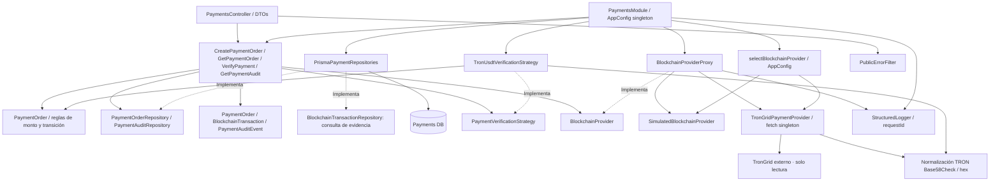

# C4 — Nivel 3: Payments Service

## Objetivo

Abrir Payments Service y distinguir contratos internos, adaptadores y composición. Las flechas representan dependencias de código; la persistencia y HTTP exterior se indican aparte.

Las flechas discontinuas indican implementación de un puerto. El módulo de composición es la única pieza de presentación que construye adaptadores concretos. El dominio no importa NestJS, Prisma ni configuración de entorno. La estrategia vive en aplicación porque implementa un puerto de aplicación; las reglas puras de dinero y transición viven en dominio.

`BlockchainTransactionRepository` está implementado por PrismaPaymentRepositories; el flujo de verificación persiste evidencia a través del commit atómico de PaymentOrderRepository. Su consulta `find` se usa en la prueba e2e para comprobar la evidencia, no es una consulta directa adicional del caso de uso.

La selección es mutuamente excluyente por configuración. Ambos adaptadores implementan BlockchainProvider; el Proxy controla el deadline y cancela las lecturas TronGrid. Los endpoints del proveedor no se importan en el caso de uso ni en Gateway.

## Responsabilidades y relaciones

- **PaymentsController / DTOs:** valida el contrato HTTP y llama a CreatePaymentOrder, GetPaymentOrder, VerifyPayment o GetPaymentAudit; no decide pagos.
- **Casos de uso:** coordinan puertos y dominio. GetPaymentAudit consulta la auditoría de una orden existente.
- **Entidades y reglas:** PaymentOrder, BlockchainTransaction y PaymentAuditEvent; monto entero, direcciones y transiciones.
- **Puertos:** repositorios, PaymentVerificationStrategy, BlockchainProvider y Logger, definidos en `application/ports/ports.ts`.
- **TronUsdtVerificationStrategy:** implementa la política de token, red, receptor, monto, vigencia y confirmaciones.
- **BlockchainProviderProxy:** implementa el puerto de proveedor y concentra timeout, reintentos y normalización.
- **SimulatedBlockchainProvider / TronGridPaymentProvider:** alternativas seleccionadas por factory; simulado interno determinista y TronGrid de lectura probado offline.
- **PrismaPaymentRepositories:** implementa los tres puertos de repositorio. Su commit escribe orden, evidencia y eventos en una transacción SQL.
- **Payments Database:** persistencia exclusiva del servicio; la FK de auditoría es local, no enlaza microservicios.
- **PaymentsModule:** Composition Root con factories e inyección singleton de Nest; es el punto que conoce adaptadores concretos.

## Clean Architecture y alcance

Las dependencias internas van hacia puertos y dominio; infraestructura implementa esos contratos. No hay dependencia de aplicación/dominio hacia Prisma, Nest o cliente TronGrid. La raíz de composición puede conocer concretos para conectarlos. Las flechas discontinuas son implementación de interfaz, no llamadas HTTP.

Todos los componentes descritos existen en el código; la consulta en vivo TronGrid sigue pendiente. RabbitMQ y los componentes de servicios futuros no pertenecen a este diagrama ni están implementados.

## Guion para el profesor

«El controlador traduce HTTP. Los cuatro casos de uso coordinan reglas y puertos. Strategy decide las condiciones del pago y Proxy protege el proveedor. Prisma implementa persistencia sin entrar en los casos de uso. PaymentsModule conecta las implementaciones con DI».
