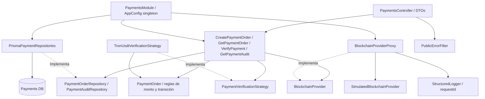

# C4 — Nivel 3: Payments Service

Las flechas discontinuas indican implementación de un puerto. El módulo de composición es la única pieza de presentación que construye adaptadores concretos. El dominio no importa NestJS, Prisma ni configuración de entorno. La estrategia vive en aplicación porque implementa un puerto de aplicación; las reglas puras de dinero y transición viven en dominio.
