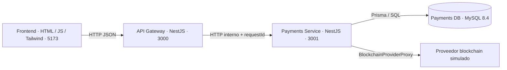

# C4 — Nivel 2: contenedores

Gateway y Payments se ejecutan en procesos distintos. Solo Payments conoce Prisma y MySQL. El frontend conoce únicamente la URL del Gateway. Los servidores se enlazan a loopback; las rutas internas no tienen autenticación y no deben exponerse públicamente. TronGrid es una alternativa futura opcional, no un contenedor implementado.
