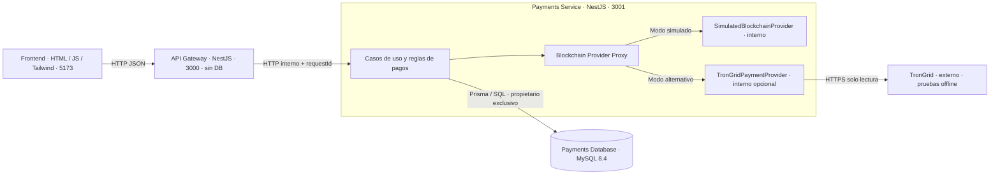

# C4 — Nivel 2: contenedores

## Objetivo

Mostrar procesos, almacenamiento y comunicaciones del MVP actual.

Gateway y Payments se ejecutan en procesos distintos. Solo Payments conoce Prisma y MySQL. El frontend conoce únicamente la URL del Gateway. Los servidores se enlazan a loopback; las rutas internas no tienen autenticación y no deben exponerse públicamente. TronGrid es un sistema externo consultado por el adaptador opcional TronGridPaymentProvider. No posee Payments DB ni se le transfieren datos de órdenes. El código del cliente reside dentro de Payments, no es otro microservicio. La conexión en vivo no fue probada.

## Responsabilidades y relaciones

- **Frontend:** formularios, estados y auditoría; todas las llamadas API van al Gateway (`frontend/src/api.js`).
- **API Gateway:** recibe los cinco endpoints públicos, enruta a Payments, propaga requestId y controla fallos de comunicación. No tiene base de datos ni reglas de PaymentOrder.
- **Payments Service:** ejecuta casos de uso, estrategia y persistencia; contiene los adaptadores blockchain internos.
- **Payments Database:** órdenes, evidencia y auditoría; propiedad exclusiva de Payments. No existe flecha Gateway → DB.
- **Blockchain Provider:** puerto detrás del Proxy; la factory elige simulado o TronGrid. No son servicios desplegados adicionales.
- **TronGrid:** sistema externo HTTPS de solo lectura; no es propietario de datos comerciales.

## Implementado y fuera del alcance

Dos procesos NestJS, frontend, MySQL y ambos adaptadores están implementados. La demo predeterminada es simulada; las pruebas TronGrid interceptan HTTP. RabbitMQ y Sales, Inventory, Cash Register e Identity no están implementados. No hay acceso directo Frontend → Payments ni Gateway → Payments Database.

## Guion para el profesor

«El navegador entra solo por el Gateway. Este delega por HTTP a Payments y añade controles de transporte. Payments es dueño de la base y decide si el pago cumple las reglas. El simulador corre dentro de Payments; TronGrid es una alternativa externa de lectura».
