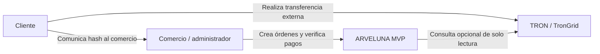

# C4 — Nivel 1: contexto

## Objetivo

Ubicar ARVELUNA entre las personas y el sistema blockchain externo, sin detalles internos.

El modo predeterminado utiliza un proveedor simulado determinista. El adaptador TronGrid opcional está implementado y probado con fixtures; su consulta en vivo no fue ejecutada. ARVELUNA no firma, transmite ni custodia fondos. El cliente realiza cualquier transferencia fuera del sistema.

## Responsabilidades y relaciones

- **Merchant / comercio:** crea órdenes, consulta estados y verifica hashes mediante ARVELUNA.
- **Customer / cliente pagador:** realiza la transferencia externamente y comunica el hash al comercio.
- **ARVELUNA:** contrasta la evidencia pública y conserva el resultado de la verificación.
- **TRON/TronGrid:** red y acceso externo de lectura; integración opcional implementada con pruebas offline, sin validación en vivo.

## Implementado y fuera del alcance

Están implementados los flujos de órdenes y el proveedor simulado interno. No se implementan custodia, firma, envío de fondos, ventas, inventario, caja ni RabbitMQ. El cliente no utiliza una pasarela de pago real de ARVELUNA.

## Guion para el profesor

«Este nivel muestra quién usa el sistema y con qué entorno se relaciona. El comercio opera ARVELUNA; el cliente paga fuera y comunica un hash. La demo usa simulación. La consulta opcional TronGrid existe en código, pero solo se probó offline».
