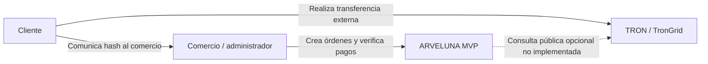

# C4 — Nivel 1: contexto

El modo implementado utiliza un proveedor simulado determinista. ARVELUNA no firma, transmite ni custodia fondos. El cliente realiza cualquier transferencia fuera del sistema.
