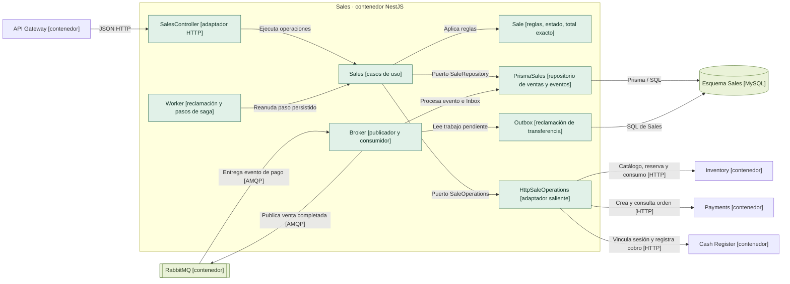

# C4 nivel 3 — Componentes de Sales

Sales encapsula el ciclo de vida de una venta. Payments valida la transferencia con su Strategy y su Proxy, y es autor de los eventos de pago. Cash Register controla el cierre y sus movimientos en una frontera propia.

## Componentes de Payments e Import/Analytics

[Vista de componentes propia de Payments](C4-payments.md).

| Contenedor | Entrada | Aplicación y dominio | Adaptadores y estado |
| --- | --- | --- | --- |
| Payments | `FullPaymentsController`, worker de expiración | `SalePayments`, `CreatePaymentOrder`, `VerifyPayment`, `TronUsdtVerificationStrategy`, reglas de monto y vigencia | `PrismaPaymentRepositories`, `BlockchainProviderProxy`, adaptadores Simulado/TronGrid, Outbox |
| Inventory | `InventoryController` | `Inventory`, cálculo entero de disponible/reservado | `PrismaInventory`, bloqueo SQL de producto, recibos de importación, Outbox |
| Import | `ImportController`, worker de filas | `Imports`, validación de columnas, cantidades y SKU | Parser CSV, `PrismaImports`, cliente HTTP Inventory |
| Analytics | `AnalyticsController`, consumidor y worker | `Analytics`, funciones `diagnostics`, `simulate` y `recommendations` | `PrismaReadModels`, colector paginado por HTTP, Inbox |

**Leyenda.** Verde claro identifica componentes del contenedor Sales, iconos de almacenamiento identifican infraestructura y las flechas muestran llamadas y titularidad. Las dependencias de código se presentan en el informe técnico.
