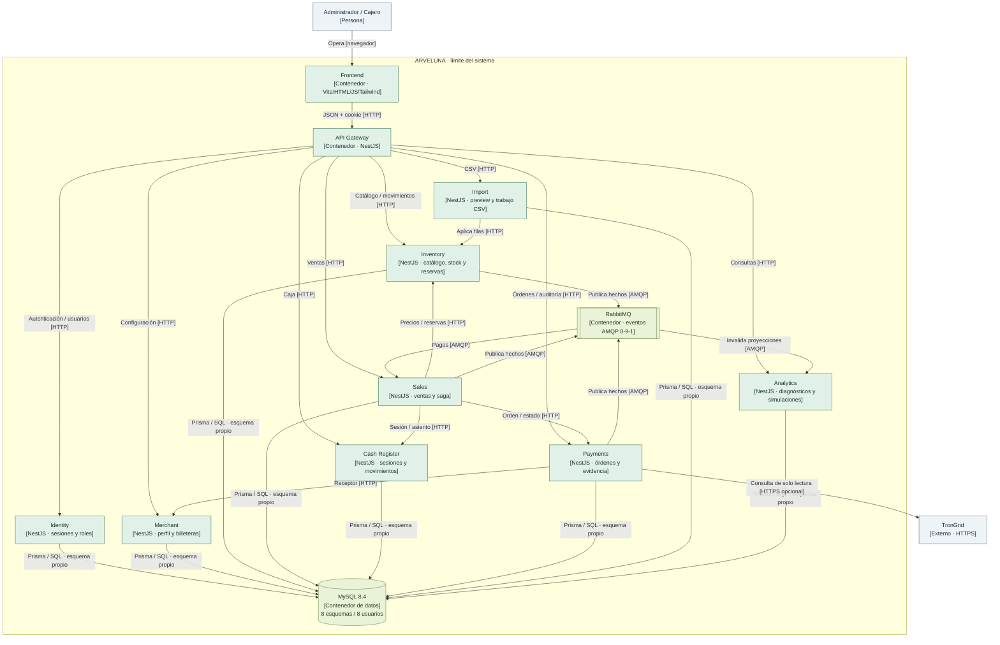

# C4 nivel 2 — Contenedores

Cada aplicación backend se ejecuta en su propio proceso NestJS. Ocho esquemas lógicos se alojan en la misma instancia local MySQL. Cada par servicio/esquema tiene un usuario SQL con permisos sobre ese único esquema.

La [vista de propiedad de datos](C4-datos.md) identifica los ocho esquemas y el usuario SQL de cada propietario. La siguiente tabla identifica las relaciones transversales de autenticación y reconstrucción.

| Origen | Destino | Relación |
| --- | --- | --- |
| Merchant, Inventory, Sales, Cash Register, Payments, Import y Analytics | Identity | Introspección de sesión con credencial interna y timeout, HTTP |
| Analytics | Inventory, Sales, Cash Register y Payments | Páginas de lectura por comercio para reconstruir el corte, HTTP |
| Payments | Simulated Provider dentro de Payments | Obtiene fixtures deterministas mediante el Proxy, en proceso |

**Leyenda.** Rectángulos verdes representan aplicaciones, siluetas verdes claras representan infraestructura o datos y azul claro representa actores externos. Las flechas etiquetadas identifican el protocolo y la responsabilidad. La tabla de propiedad en el informe técnico identifica cada esquema.

En la demo histórica, Vite reenvía `/api` al Gateway del perfil activo.
