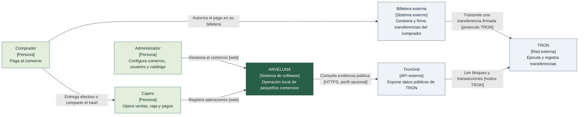

# C4 nivel 1 — Contexto

El comercio coordina sus operaciones y verifica transferencias públicas. El cliente transfiere desde un medio externo y comparte la referencia con el cajero. El modo simulado ejecuta el mismo flujo de verificación de la aplicación con datos locales.

**Leyenda.** Verde claro representa personas, verde oscuro representa ARVELUNA y azul claro representa un sistema externo. Las flechas muestran el iniciador y la relación.

El perfil ARVE de prueba usa Shasta simulado. El perfil opcional con TronGrid solo lee evidencia de la red seleccionada. La firma permanece en la billetera externa.
