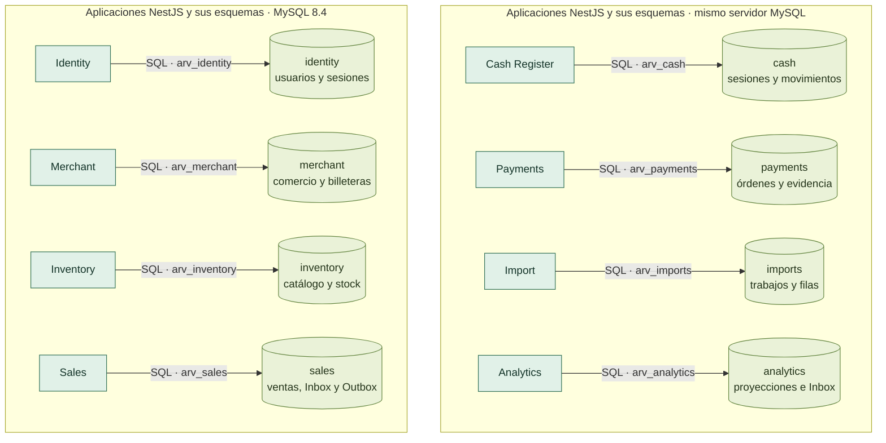

# C4 nivel 2 — Propiedad de datos

Vista complementaria de los contenedores de datos. Cada aplicación NestJS abre una conexión SQL con su propio usuario. Los ocho esquemas lógicos comparten el servidor MySQL 8.4 y el volumen del perfil. El Gateway solo tiene salidas HTTP.

**Leyenda.** Rectángulo para el proceso NestJS, cilindro para el esquema y flecha con nombre del usuario SQL. Los prefijos físicos son `arveluna_full_` y `arveluna_full_test_` según el perfil.
