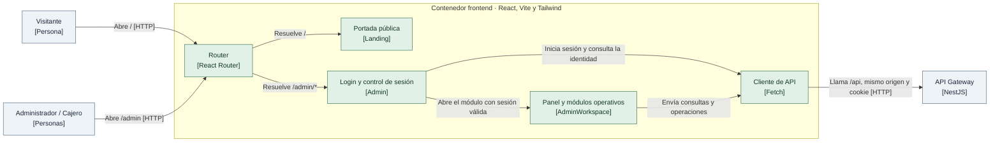

# C4 nivel 3 — Componentes del frontend

**Leyenda.** Verde representa componentes del frontend y azul representa actores o contenedores externos. Las flechas nombran la operación desde el iniciador. Vite sirve la aplicación al acceder o recargar una ruta directa. El cliente solo llama al Gateway. El control de acceso del navegador orienta la navegación y el backend aplica sesión, rol y alcance del comercio.
