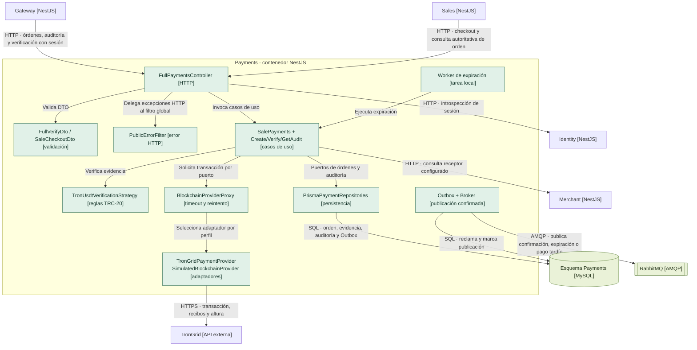

# C4 nivel 3 — Componentes de Payments

Vista del contenedor en modo aplicación completa. La demo histórica es un proceso de arranque explícito con una base separada. La API pública del Gateway carece de una ruta para crear órdenes libres en el perfil completo.

**Leyenda.** Verde claro identifica componentes NestJS dentro de Payments. El cilindro es su esquema MySQL y el doble borde es RabbitMQ. Los demás nodos exteriores son procesos NestJS u otro sistema. Las flechas indican iniciador, destino y propósito. El adaptador TronGrid obtuvo los recibos de Shasta en la prueba verificada.
