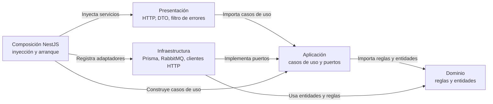

# Dependencias de código — Clean Architecture

Esta vista describe dependencias del código fuente. El módulo NestJS de composición enlaza puertos y adaptadores. Las vistas C4 describen la ejecución, propiedad de datos y protocolos.

`scripts/check-architecture.mjs` verifica que el dominio y aplicación preserven sus fronteras y que el Gateway carezca de acceso SQL.
