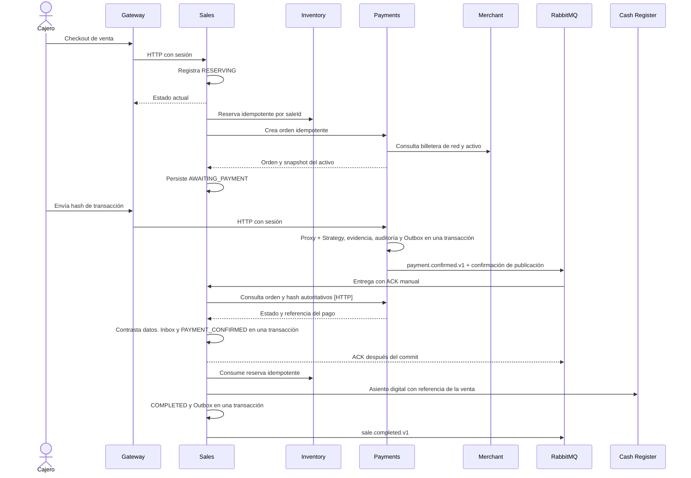

# Secuencia de checkout TRC-20

La ruta en efectivo fija la sesión abierta antes de reservar. El ingreso en efectivo y el cierre toman el mismo bloqueo sobre la caja. Un cierre que gana el bloqueo impide ingresar a esa sesión. La venta libera su reserva si el ingreso fue rechazado. Un ingreso confirmado y su reintento conservan el mismo movimiento, incluso tras cerrar la sesión.
