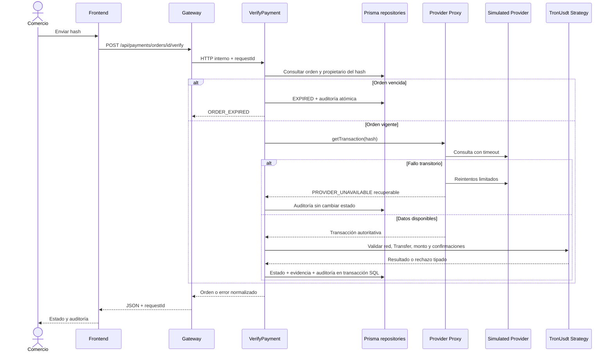

# Secuencia de verificación

La unicidad SQL del hash en PaymentOrder impide que dos verificaciones concurrentes consuman la misma transferencia. El update condicional impide que un resultado tardío sobrescriba un estado terminal. CONFIRMED con el mismo hash es idempotente.
